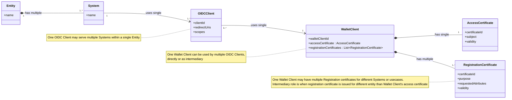

# Tenant structure of Wallet API 

Wallet API provides multiple levels on which calling application are separated from Wallet
Following are entities that are implementing tenancy:
- Wallet API's OpenID Client (OIDC Client)
- Wallet Client 
- Issuer as special case of OIDC Client 

